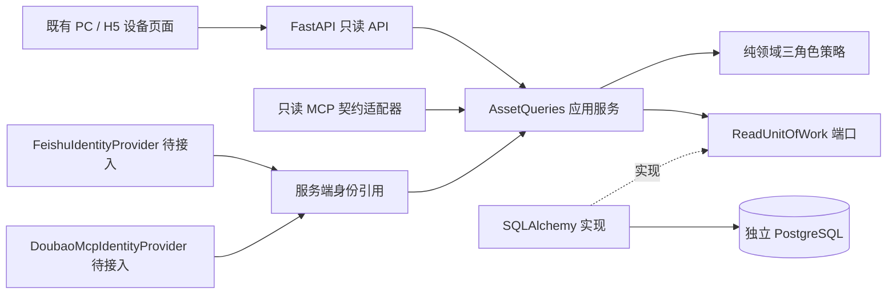
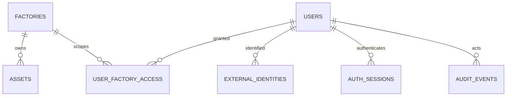

# ADR-0005：独立数据库、即时工厂授权与多渠道设备只读查询

- 状态：M1-01 已实现，等待 Draft PR 评审；未部署。
- 任务：`FACTORY_OPS_M1_01_MINIMAL_BUSINESS_FOUNDATION`。
- 基线：M0.5 页面及其收尾工作；保留 M0.6 冻结静态预览。

## 决策

继续单仓库、模块化单体。PostgreSQL 17 是工厂、授权及设备业务事实的存储，SQLAlchemy 2
实现持久化端口，Alembic 是唯一建表入口。飞书 H5 与豆包企业工作伙伴只是接入渠道，
不能以飞书通讯录、对话记录或客户端工厂选择代替业务数据库及授权。

API 只依赖 Application，Application 只依赖 Domain 和自身端口，Domain 只用标准库。
根组合入口 `factory_ops.bootstrap:app` 注入 SQLAlchemy 实现；导入应用不会连接数据库、
迁移或生成账号。原 `factory_ops.api.app:app` 仍可用作无数据库的健康检查入口，业务访问拒绝放行。

## 本轮实际表与限制

| 表 | 本轮约束及内容 |
|---|---|
| factories | UUID、唯一工厂编码、名称、启用状态 |
| users | 内部 UUID、可为空的三管理角色、启用状态、创建时间；无需姓名、电话、邮箱 |
| user_factory_access | 用户/工厂复合主键、两侧外键；不复制到会话中 |
| external_identities | provider + issuer + tenant_id + app_id + subject_id 唯一绑定；可停用 |
| auth_sessions | 不透明会话的 SHA-256 摘要、用户、签发/过期/撤销时间；不存原始令牌 |
| assets | UUID、工厂外键、厂内唯一编号、名称、分类、位置描述、厂家、型号、出厂编号、状态、版本与时间 |
| audit_events | 操作者、请求工厂/资源 ID、操作、允许/拒绝、渠道、UTC 时间；追加审计 |

分类暂为 `refrigeration / processing / utilities / other`，状态为
`pending / in_use / inactive / retired`。状态不代表完整生命周期流程，也不是实时运行状态。
位置是只读描述，不冒充位置树、功能机位或安装历史。附件、位置实体、安装历史、外部监控映射、
outbox、幂等键以及其他运维表均未在本轮创建。未来扩展遵循原有
[数据模型草案](data-model.md)，不得用直接覆盖位置或工厂来实现调拨。

## 身份与工厂隔离

平台只接受服务端已签发的不透明会话（HttpOnly Cookie 或 Bearer）。每次用例创建新的
SQLAlchemy Session，重新验证会话签发时间、期限、撤销状态、用户启用状态，并从数据库加载
当前角色及工厂授权。角色/授权不放在客户端 JWT、localStorage 或进程级缓存中。
授权变更事务提交后的新请求即被拒绝；本轮没有并发撤权与已经开始的查询之间的全局锁定保证。

- 集团负责人：所有启用工厂。
- 工程师：明确授权的零个或多个工厂。
- 加工厂设备管理员：明确授权的至多一个工厂；若数据库误配多个工厂，整个管理身份拒绝放行。
- 无角色、停用用户、未知/过期/撤销会话：无设备查询能力。

列表查询、计数和详情全部带服务端通过授权的工厂过滤；客户端 `factory_id` 仅是待验证的查询范围。
详情同时限制真实 `asset.factory_id` 和 UUID，不能把 B 厂设备 UUID 套入 A 厂路径。
返回 DTO 只有基础字段，无用户、外部身份、令牌、附件或对象存储地址。

成功查询与已认证身份的授权拒绝写审计，审计提交失败则回滚并返回 503，不返回已读取的设备。
审计只存必要标识，不存原始身份凭证或搜索文本。数据库触发器拒绝审计 UPDATE/DELETE；
数据库所有者仍可改变表/触发器，正式环境的迁移账号与最小权限运行账号分离留待上线前落实。
未认证、请求语法错误和不存在资源的完整安全事件流水尚未实现。

## 渠道边界与兼容

当前 `FeishuIdentityProvider`、`DoubaoMcpIdentityProvider` 均抛出 `IdentityUnavailable`，
没有外部认证成功路径。MCP 仅有 Python 只读契约适配器，无对外监听、豆包连接或写工具；
契约测试中的已验证身份是隔离测试替身，未接入运行时组合入口。
二者后续均调用同一 `AssetQueries`，不得直接操作数据库。见
[身份适配设计](IDENTITY_ADAPTERS_M1.md) 与 [HTTP/MCP 契约](../api/M1_01_ASSET_READ.md)。

现有页面通过 `VITE_ASSETS_API_ENABLED=true` 开启设备只读查询，默认仍为未接入的空壳模式。
这只是构建能力开关，不授予权限，也不会生成测试数据或会话。启用后 PC 台账、PC/H5 设备详情
读取同源 API，明确显示加载中、无数据、查询失败、无权限；失败/撤权后清空旧设备结果。
其他模块、操作及预览页面仍明确待开发，未增加假保存或假登录。

M0.6 Pages 工作流及其冻结源 SHA、静态预览 ADR、说明与产物检查脚本均保持不变。
本轮 CI 仅构建和测试，不发布业务版本或静态预览。

## 迁移与回滚

初始修订 `0001_m1_foundation` 创建七张表、索引、约束及审计追加触发器，不预置业务记录。
显式执行 `alembic -c backend/alembic.ini upgrade head`，连接来自环境 `DATABASE_URL`。
迁移不会由应用启动自动执行；不得针对真实库运行本轮测试。

隔离空库可用 `downgrade base` 后再次升级验证可逆性；降级会删除七张表及其数据。
对任何已保存数据的评审环境，应用回退优先关闭读能力开关、回退代码并保留数据库，
再经评审选择前向修复或备份恢复，不直接执行破坏性降级。本轮仅测试独立合成数据库。

验证覆盖反复升级/回滚、失败迁移的 PostgreSQL 事务 DDL 回滚与重试、元数据一致性、
厂内唯一编码/外键/角色约束、跨厂查询、旧会话撤权、审计失败及原页面兼容。
证据及剩余限制见 [M1-01 验证记录](../delivery/M1_01_VERIFICATION.md)。
