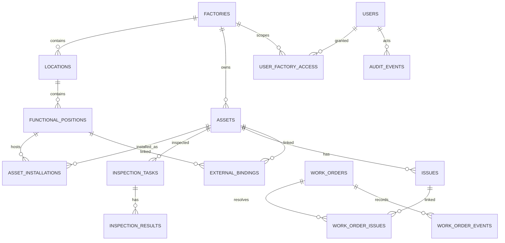

# 数据模型：M1-01 实际范围与 M0 全量草案

M1-01 已通过 Alembic 创建 `factories / users / user_factory_access / assets /
external_identities / auth_sessions / audit_events` 七张表，未预置业务记录。
实际约束、迁移与局限见 [ADR-0005](ADR-0005-minimal-business-foundation.md)。
下文是 M0 的全量设计基线；除上述最小范围外仍未实现，不能当作已有数据库结构。

## M1 先建的实体

- `factories`、`locations`、`functional_positions`：单独 UUID 及工厂作用域。
- `users`、`user_factory_access`、`external_identities`：业务用户与飞书 `tenant_key + app_id + open_id` 等有效身份唯一绑定；不要通过姓名判等。
- `asset_categories`、`assets`、`asset_installations`、`asset_qr_tokens`、`attachments`：实物资产与位置的有效期关系；老履历不能覆盖。
- `audit_events`、`outbox_events`、`idempotency_keys`：所有重要写操作事务内同步落库，通知异步派送。

## M2-M5 按阶段实施

- `inspection_templates`、`inspection_template_versions`、`inspection_plans`、`inspection_rounds`、`inspection_tasks`、`inspection_results`。
- `issues`、`issue_sources`、`issue_events`、`work_orders`、`work_order_issues`、`work_order_events`、`work_order_verifications`、`work_order_downtime`。
- `maintenance_plans`、`parts`、`warehouses`、`inventory_transactions`。
- `measurement_points`、`external_bindings`（目标为有外键约束的设备/位置/测点，带有效期）、`monitor_events`、`integration_cursors`。

## 约束和唯一性

- `assets.id` 不变；厂内 `asset_code` 仅在同一工厂内唯一，编号变更保留原值历史和事件。
- `asset_installations` 保留起止有效期；不允许同一设备在同一时刻安装于两个互斥机位。
- `external_bindings` 保留来源、外部 ID、目标、厂作用域与有效期；禁止靠设备名称模糊关联。
- 同一问题可产生多次维修尝试；一个工单可处理多个问题。
- 巡检结果引用已发布模板版本；过期、迟检、代检及补录不得覆盖原始任务状态。
- 带厂属性的表在业务 API 侧检查工厂授权；附件访问额外做所有权与期限校验。
- 审计事件追加写；历史更正通过明确更正事件，不在业务 API 直接物理删除。

**M0 不进行生产数据迁移，不创建真实机位编码，M1 才落地 Alembic。**

## M1 需落实的约束和历史策略

- `locations` 是位置树，`functional_positions` 是固定功能位，`assets` 是可移动物理资产，
  `measurement_points` 是可属于资产、机位或区域的测点；四种 ID 互不代用。
- 所有厂级外键应包含 `factory_id` 的一致性校验（复合外键或等价约束），不能只校验两个 UUID 存在。
  层级位置不得跨厂挂接或形成环；工单/问题关联表两侧也必须属于同一工厂。
- 安装/外部映射的有效期使用 UTC、左闭右开 `[valid_from, valid_to)`，开放末尾用 NULL，
  校验结束晚于开始。M1 采用 PostgreSQL 排斥约束或等价事务锁防止并发重叠；不只在前端检查。
- `external_bindings` 必须恰有一个带外键的目标：`asset_id`、`position_id`、`location_id`、
  `measurement_point_id`。同一 `source_system + external_id + 对象类型 + factory_id`
  在同一时刻不得出现冲突目标；多个测点关联同一资产是允许的。
- 跨厂调拨需校验交接两厂的操作资格和集团确认，关闭原安装区间并产生调拨事件。
  旧问题、工单、附件访问仍依据发生时 `factory_id` 与历史授权规则；不能因当前资产归属变化泄露旧厂历史。
- `external_identities` 的 `(tenant_key, app_id, open_id)` 唯一；本地授权变更与会话撤销留痕。
- `idempotency_keys` 以 `actor + factory_id + operation + key` 唯一，保存请求指纹和结果；
  相同键不同请求拒绝，失败事务不占用成功结果。并发更新用版本号，冲突返回明确错误。
- 业务状态、追加审计和 outbox 同一事务提交；worker 至少一次投递，收件端/投递表按事件与接收方去重。
  outbox 持久化状态、重试次数、下次重试和最终失败原因，不能仅靠进程内队列。

以上全量扩展仍为设计预留；M1-01 仅验证前述七张表约束。资产导入/编码设计见
[数据基线](../data/ASSET_BASELINE.md)，接口约束见 [API 目录](../api/README.md)。
