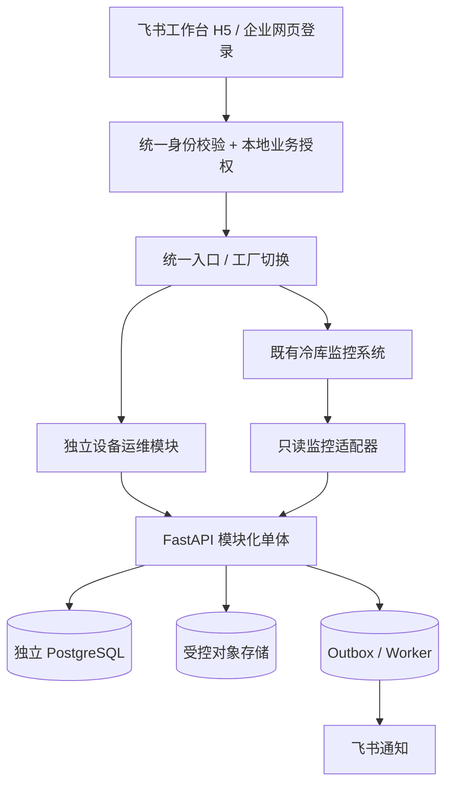

# M0 系统架构基线

M1-01 已在此基线上新增独立数据库、真实会话校验、工厂隔离及设备只读 API，
保留 M0.5 既有页面。当前实际架构以 [ADR-0005](ADR-0005-minimal-business-foundation.md)
为准。下文保留 M0 阶段的全量设计与当时状态，未实现模块不可据此视为已接入。

> 设计稿，不代表现有飞书/监控接口已经实测或功能已经实现。

## 模块边界

| 模块 | 职责 | 初始阶段 |
|---|---|---|
| identity | 飞书身份映射、三角色、工厂授权、会话回收 | M1 |
| factories | 工厂、车间、区域及位置树 | M1 |
| assets | 资产台账、分类模板、安装历史、二维码、附件 | M1 |
| inspections | 模板版本、巡检周期、路线、任务、异常 | M2 |
| issues | 巡检/报修/告警统一的问题登记、分类、去重 | M3 |
| work_orders | 派工、维修、暂停、返工、独立验收 | M3 |
| maintenance | 预防保养计划与执行 | M4 |
| inventory | 轻量备件入出库、领退料 | M4 |
| integrations | 飞书通知与监控只读适配 | M1/M3/M5 |
| audit | 业务事件、审计、幂等、Outbox | M1 起贯穿 |

## 关键约束

- API → Application → Domain；Persistence/飞书/监控适配层位于 Infrastructure。
- 每个写操作：身份验证 → 工厂范围验证 → 资源/状态条件 → 同事务业务变更+审计+Outbox → 响应。
- 监控数据只读，不能变更设备控制参数或对 PLC 下发操作。
- 真实业务写操作不调用外部飞书通知作为同步事务的一部分；异步失败不影响已提交的业务事实。
- 巡检与维修移动优先，照片失败重试，未提交草稿不算已完成。
- 当前 M0 仅公开 liveness `/api/v1/health`，不具备 readiness、认证、数据库、业务接口。

## 工程目录和依赖守卫

`backend/src/factory_ops/` 采用纵向业务模块、横向技术分层的模块化单体：

- `api/`：HTTP 请求/响应和应用服务调用；M0 只有健康检查。
- `application/`：预留用例、事务编排和外部端口；尚未实现业务。
- `domain/`：纯业务规则；当前仅三角色及独立验收的策略示例。
- `infrastructure/`：预留 PostgreSQL、飞书、监控和对象存储适配器；尚无连接。

M1 起按上表的模块名在各层增加包（例如 `application/assets/`、
`domain/assets/`、`infrastructure/assets/`），不用十套独立服务或空目录冒充模块。
业务端口定义在 Application，Infrastructure 实现端口；后续组装入口单独承担依赖装配，
Domain 不引用外层。`backend/tests/test_architecture.py` 对当前源码执行 AST 导入检查：
Domain 仅依赖标准库和自身、Application 不依赖 API/Infrastructure、API 不直接访问
Domain/Infrastructure、Infrastructure 不依赖 API。它检查静态导入，不能代替代码审阅或运行时沙箱。

`frontend/src/api/` 封装类型和 HTTP 契约；`App.vue` 仅展示工程状态。
M1 需要业务页面时再添加路由、工厂上下文及 `features/assets/`，前端上下文不构成授权。
健康请求 5 秒超时，避免网络无响应时永久停留在“检查中”。

接口现状见 [API 契约](../api/README.md)，本轮设计审阅与未核实项见
[M0 架构审阅](M0_REVIEW.md)。

## 尚未确定且必须实测

- 现有冷库监控系统仓库/接口地址及鉴权与可用性，不得混同冷库规划助手仓库。
- 飞书应用租户、企业自建应用流程、组织字段可用性、离职事件可用性和 H5 扫码相机表现。
- 服务器容量/部署网络/证书/日志与备份策略，需用户授权后再调研，不自动操作生产。
- 试点工厂实际巡检周期、设备台账字段模板、设备编码和责任人。
