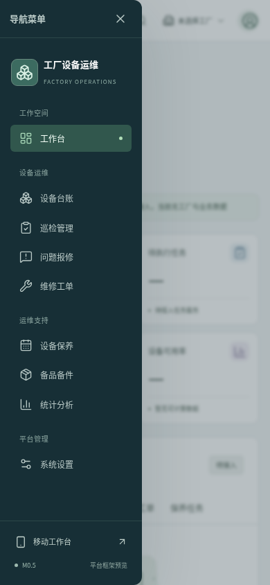
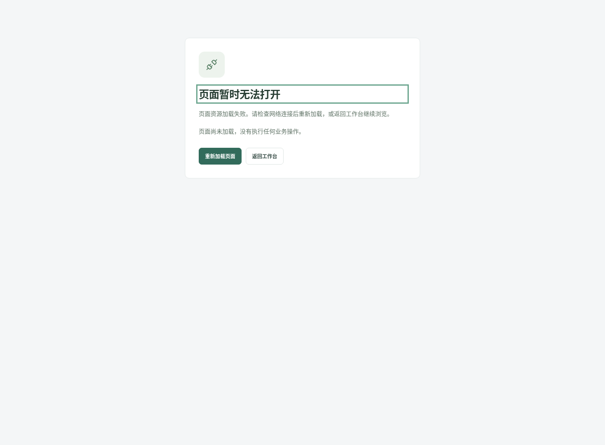

# M0.5 导航与加载失败恢复收尾

日期：2026-11-01。沿用任务 `FACTORY_OPS_M0_5_PLATFORM_SHELL`，仅继续界面空壳范围。

## 基线与范围

已读取并同步远程更新：M0 PR #1 已合并至 `2f23bb38af875157ea4811d5d0b7b5287912008c`，
M0.5 PR #2 已合并至 `fa5562c9b9753fdfda6ab090991d07dfdfca2cb3`。
后续分支 `codex/m0-5-shell-resilience` 从后一个 main 提交建立，已创建
[Draft PR #3](https://github.com/xuezhiorange-png/factory-operations-platform/pull/3)；
本轮不向已合并 PR 追加提交，不 Ready、合并、部署或修改生产。

## 修正内容与验证依据

1. 原窄屏管理端菜单打开时焦点仍留在背景，键盘不能顺畅进入导航；改为复用原生模态抽屉，
   菜单内容抽成共享组件，与桌面侧栏保持一致。Tab/Shift+Tab 首尾循环，Escape 关闭并恢复触发按钮焦点。
2. 菜单打开后切换到宽屏会关闭模态并清理遮罩；可立即操作宽屏导航、工厂说明弹窗，无背景锁定残留。
3. 原懒加载页面脚本失败后只结束进度条，可能留下旧页或空白。现在显示静态打包的恢复页，
   重新加载原目标以清除失败模块缓存，也可以返回对应 PC/H5 工作台。过期导航失败不会覆盖已打开的新页，返回已打开的工作台时同步恢复页面标题。没有自动重试、原始错误/参数展示或业务操作。
4. 增加真实页面加载等待、首次 H5 加载失败、导航失败重试及恢复测试；统一修正过期的合并/基线说明。

修正前新增的菜单焦点与加载失败用例均能复现失败；修正后完整回归通过。
故障测试只中断本地静态 JavaScript 请求，不模拟业务数据、不访问真实系统。

## 本地验证

| 检查 | 结果 | 证据 |
|---|---|---|
| Vue / TypeScript / Vite | PASS | Node 22 下 `npm run build`，包括应用和测试代码类型检查 |
| Chromium 浏览器回归 | PASS | `npm run test:e2e`，**73 passed（33.6s）**：59 项功能/响应式/基础无障碍检查及 14 项截图采集 |
| 新增交互用例 | PASS | 菜单焦点、跨断点释放、失败重试、H5 失败返回、真实加载等待、重复返回标题、过期导航失败隔离 7 项 |
| 原有安全边界 | PASS | 未发出业务 API、写请求或外部请求；相机探针未触发 |
| 原有后端 / Ruff | PASS | 32 passed，既有 1 条 Starlette/httpx 弃用警告；后端、健康契约原样保留 |
| 文档与 Actions 静态检查 | PASS | `python scripts/check_docs.py` / actionlint，外链和锚点未验证 |
| 实际截图 | PASS | 原 12 张页面截图重新采集，另有菜单和失败恢复状态，共 14 张 |
| 远程 CI / Draft PR | 以最新 Checks 为准 | 创建后在 PR 正文记录最新 SHA、实际运行链接与作业结果，不以本地结果替代 |

复现：

```bash
cd frontend
npm ci --no-audit --no-fund
npm run build
npx playwright install --with-deps chromium
npm run test:e2e
# 显式更新已提交的截图：
CAPTURE_SHELL_SCREENSHOTS=1 npm run test:e2e -- --grep '交付截图'
```

本地现有 Chromium 可通过 `PLAYWRIGHT_CHROMIUM_EXECUTABLE_PATH=/usr/bin/chromium` 选择；
CI 使用 Playwright 配套 Chromium。只运行 127.0.0.1 的 preview，不是部署。

## 新增状态截图





[全部截图](screenshots/m0-5/README.md) · [模块与接口边界](../architecture/FRONTEND_SHELL.md)

## 风险与回滚

- 仍无业务 API、数据库、认证/授权、飞书 SDK、真实扫码或监控接入；所有业务按钮继续禁用。
- 原生 dialog 与尺寸模拟已在 Chromium 验证，飞书真机、Safari/WebKit 和完整无障碍合规仍为 UNVERIFIED。
- 加载失败恢复覆盖路由模块加载；整个入口脚本无法下载、浏览器不执行 JavaScript 等情况不由该组件兜底。
- 回滚仅撤销本后续 PR 的前端/测试/文档变更，恢复已合并的 M0.5 界面；无数据库迁移或外部副作用。
