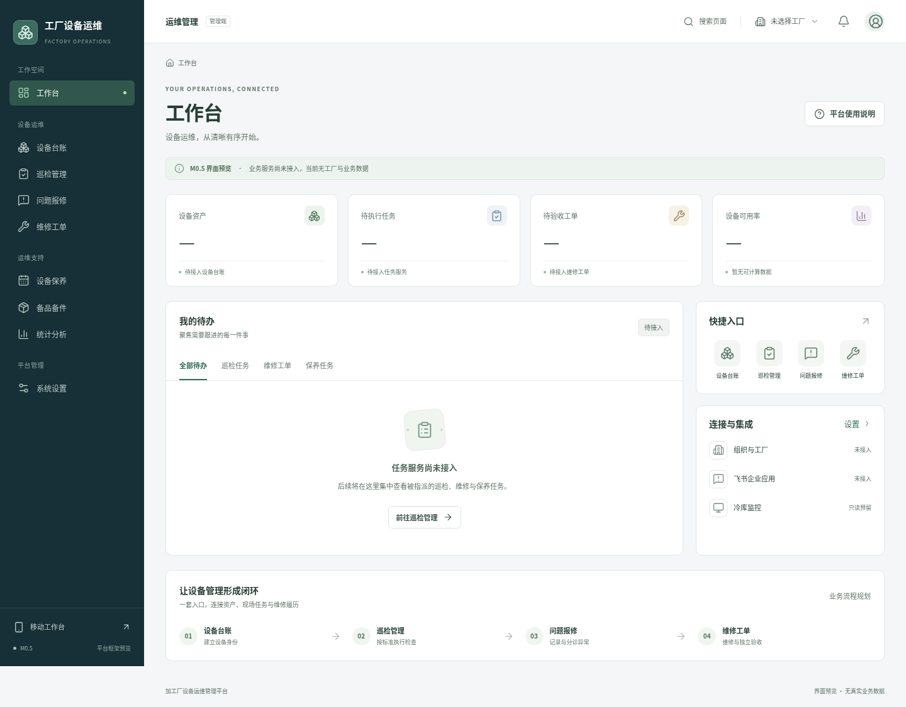
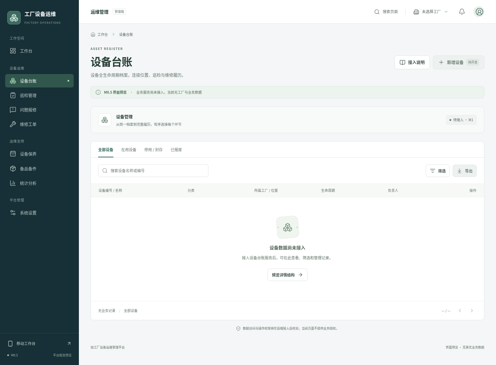
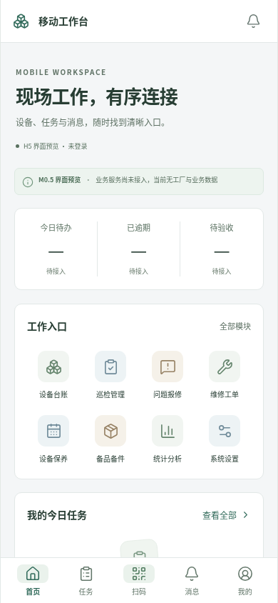

# M0.5 平台空壳交付与验证

日期：2026-11-01  
TASK_ID：`FACTORY_OPS_M0_5_PLATFORM_SHELL`  
分支：`codex/m0-5-platform-shell`，依赖 M0 的 `codex/m0-bootstrap`（基线 `adc5856d4daf117535eaafbf03c8422356c14ceb`）。

## 实现范围

- 14 个 PC 页面、18 个 H5 页面，以及两端 404；全部八个主要模块、四类二级详情结构。
- PC 顶部导航/侧栏/面包屑/工作台，H5 首页/任务/扫码/消息/我的与模块入口。
- 公共颜色、字体、卡片、表格、筛选、表单、页签、弹窗/抽屉、空状态与加载状态。
- 模块独立目录、拟定读端口、三角色展示和飞书/监控接口边界；未实现任何业务服务。
- 本轮依赖 M0 的独立 Draft PR，不 Ready、不合并、不部署；保留 M0 后端与健康契约原样。

## 本地实测

| 检查 | 结果 | 证据 |
|---|---|---|
| Node 22 / npm 锁定安装 | PASS | Node 22.23.4、npm 10.9.9；`npm ci --no-audit --no-fund` |
| Vue / TypeScript / 测试代码类型检查与 Vite 构建 | PASS | `npm run build`，同时检查应用和 Playwright TS |
| Chromium 浏览器回归 | PASS | `npm run test:e2e`，64 passed（29.5s）；路由/刷新、交互、响应式、未接入边界与截图 |
| 六页 axe 基础扫描 | PASS | 工作台、设备台账、设备详情、角色设置、H5 首页、H5 扫码；wcag2a/2aa/21aa 标签 |
| 后端回归 | PASS | `.venv/bin/python -m pytest -q backend/tests`，32 passed / 1 条既有 Starlette/httpx 弃用警告 |
| Ruff | PASS | `.venv/bin/ruff check backend scripts` |
| Actions 静态检查 | PASS | actionlint 1.7.7，CI 增加 Chromium/E2E 与验证 artifact，无部署 |
| 文档基线与本地链接 | PASS | `.venv/bin/python scripts/check_docs.py` |
| 主要页面截图 | PASS | 12 张实际 Chromium 截图，PC 1440×1060（全页），H5 390×844（视口） |
| GitHub 远程 CI / Draft PR | PENDING | 推送后核对真实作业及最新 SHA，不以本地检查冒充远程结果 |

复现（在 frontend，安装 Node 22.12+ 与 npm 10 后）：

```bash
npm ci --no-audit --no-fund
npm run build
npx playwright install --with-deps chromium
npm run test:e2e
# 明确需要更新仓库内交付截图时：
CAPTURE_SHELL_SCREENSHOTS=1 npm run test:e2e -- --grep '交付截图'
```

本地使用现有 `/usr/bin/chromium` 时，可通过
`PLAYWRIGHT_CHROMIUM_EXECUTABLE_PATH=/usr/bin/chromium` 运行浏览器测试；CI 使用 Playwright 配套 Chromium。
浏览器回归基于生产构建的本地 preview（仅 127.0.0.1:4173），无需后端，不是部署。
测试会阻断并检查非本地请求、业务 `/api/` 请求和所有写请求；同时检查未捕获的浏览器异常。
扫码检查替换 getUserMedia 为拒绝探针，确认页面没有调用相机；不访问真实设备。

## 截图

[完整截图目录与路由](screenshots/m0-5/README.md)







## VERIFIED / UNVERIFIED

VERIFIED：本地页面框架、路由与刷新、筛选与页签展示、原生 dialog 焦点、320/390/768/1024/1440 宽度抽查、
六页基础 axe 扫描、没有业务或外部请求、实际截图与已有后端回归。

UNVERIFIED：真实认证/授权/撤权、所有业务读写、业务数据库/事务/迁移、飞书 SDK/身份/企业消息、
监控真实 API/映射/SSO/webhook、真机飞书 WebView、Safari/WebKit、离线照片、生产性能与部署。
基础扫描不等于完整可访问性合规，宽度模拟也不等于实际移动设备验收。

## 风险、后续与回滚

- 所有业务仍未实现；前端可访问不代表后端已授权，不存在登录会话或角色模拟。
- main 尚未启用分支保护；本轮不改变仓库可见性、设置或 M0 PR 状态。
- Python 原有弃用警告和依赖未完整锁定仍存在，本轮不扩大后端范围。
- 后续按模块建立正式 API、后端工厂校验、事务/审计/幂等与真实状态后，再启用当前禁用的业务操作。
- 未建库、未迁移、未写外部配置；回滚为撤销本轮提交以恢复 M0 前端，不需生产操作。

接入步骤与目录边界见 [前端接入说明](../architecture/FRONTEND_SHELL.md)，
设计决策见 [ADR-0003](../architecture/ADR-0003-platform-shell.md)。
