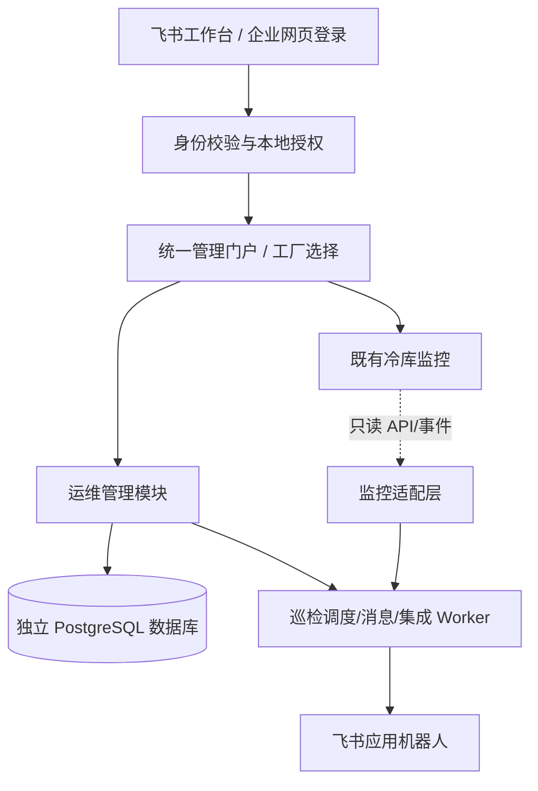

# 加工厂设备运维管理平台 V1.3｜整体开发计划与遗漏修订

> 版本：V1.3（2026-11-01）  
> 文档定位：完整开发基线与可交付实施路线，不代表已开发或部署  
> 范围：**全厂设备**；**统一入口 + 独立运维模块**；**飞书企业自建应用**；**与既有冷库监控只读联动**  
> 权限约束：正式管理角色固定为**集团负责人 / 工程师 / 加工厂设备管理员**，不引入多级审批引擎或十余种角色。

## 0. 本次审查结论

原 V1.2 已具备设备台账、巡检、报修、工单、保养、备件、飞书身份、监控联动等基本模块。本次不是推倒重做，而是补齐**落地数据准备、资产生命周期、巡检执行例外、重大故障闭环、人员与任务关系、运营保障和试点推广**，并消除开发阶段编号混用。

### 0.1 主要遗漏与处理

| 序号 | 漏项或不足 | 修订决定 | 上线级别 |
|---|---|---|---|
| G01 | 设备接收/安装/替换/调拨/封存/报废流程不完整 | 生命周期与设备安装历史单独设计 | 必须 |
| G02 | 台账只有“导入功能”，没有现场盘点与责任人 | 出台账模板、盘点规范、唯一编码规则、导入对账方案 | 必须 |
| G03 | 路线/班次/代检/漏检/补录规则不够完整 | 引入巡检批次与设备检查任务、任务变更记录 | 必须 |
| G04 | 谁能执行任务与三角色之间关系未完全澄清 | 三种管理角色固定；任务指派与管理角色分离 | 必须 |
| G05 | 同一故障反复修理、复机确认、应急升级存在灰区 | 问题 Issue 与工单 WO 分离；返修、停机与复机状态留痕 | 必须 |
| G06 | 设备与“机位/冷间/监控测点”有错绑风险 | 设备、功能位置、测点、有效期映射分离 | 必须 |
| G07 | 工单指标有字段但采集与口径不够明确 | 记录响应、维修、待件、停机、验收时间轴，未齐不计算 MTTR/MTBF | 必须 |
| G08 | 飞书异常场景与账号回收的测试不够具体 | 离职撤权、通知失败、工作台/浏览器、扫码兼容、断联兜底 | 必须 |
| G09 | 备件系统可能与工厂 ERP/原有库存重复 | 先识别数据责任方；最初仅实现与工单相关的轻量领退流水 | 第二批 |
| G10 | 培训、双轨试运行、数据回填和推广缺实施门槛 | 试点厂按阶段验收，形成 SOP 和复制模板 | 必须 |
| G11 | 附件、照片的安全归档及历史不可变更需加强 | 业务事件追加写、对象存储受控授权、纠错留痕 | 必须 |
| G12 | 高风险维修安全边界需要突出 | 只做流程提醒/安全状态记录，不远程启停 PLC、不替代现场锁定挂牌 | 必须 |

### 0.2 不应为一期增加的内容

不新增可配置十几种角色、复杂审批引擎、在线采购/财务 ERP、独立考勤系统、人员实时定位、AI 自动故障判断、远程电气控制，也不将飞书多维表格作为核心业务数据库。以上功能均可以留接口但不拖累核心闭环。

## 1. 产品结构：统一入口、独立业务



现有 `cold-storage-planning-agent` 是冷库规划与计算项目，不视为监控平台源码；运维管理系统建议单独建仓、独立数据库、独立发布。监控系统现有认证方式与事件接口需在 M0 实测，**不可因为有查询接口就推断已支持 SSO 或告警 webhook**。

**平台原则**：监控系统提供运行数据与原始告警；运维系统提供资产、巡检、报修、维修、保养事实记录。监控告警恢复不自动关闭工单，工单关闭不修改监控历史。任何阶段不向 PLC/控制器发出启停、复位、参数修改命令。

## 2. 全厂设备台账（第一开发重点）

### 2.1 设备分类与实体边界

- 制冷：压缩机、冷凝器、蒸发器/冷风机、阀组、水泵、冷媒机组、冷库门等；
- 生产加工：清洗、分选、分级、输送、包装、称重、码垛等；
- 公用工程：变配电、空压机、给排水、消防、暖通、制水、叉车及辅助设备；
- 允许产线/设备组层级与可维护组件（例如整台分选机—电机—减速机）。是否将一个部件建独立资产，以能否独立采购、移位、维修和核算为准。

**四类身份不得混淆**：

1. **资产 asset**：物理设备，具有不可变全局 ID；
2. **功能位置 functional_position**：固定机位、产线工位、机房设备位；
3. **位置 location**：集团—工厂—车间—区域—冷间等位置树；
4. **监控对象 measurement_point / external binding**：运行设备、传感器或测点的外部 ID，可能一个设备对应多个测点，测点也可能属于区域而非实物设备。

设备搬迁或更换要产生安装关系历史（`asset_installations`：asset_id, position_id, valid_from, valid_to, change_reason），不能直接覆盖旧位置；跨厂调拨需保留旧厂履历和原编号快照。

### 2.2 基础档案字段

资产 ID / 厂内设备编号 / 名称 / 分类 / 厂家 / 型号 / 出厂编号 / 技术参数 / 功能位置 / 归属工厂 / 设备负责人 / 重要等级 / 采购与验收日期 / 投运日期 / 保修截止 / 供应商 / 当前生命周期状态 / 说明书与图纸 / 设备铭牌照片 / 二维码 / 监控映射 / 修改履历。分类专属字段（例如制冷剂、额定功率、电压、额定处理能力等）采用受验证的扩展模板。

**生命周期至少包含**：待建档→待验收/待安装→在用→停用/封存→移位/调拨→报废。短期故障/维修中属于**运行可用状态**，与资产生命周期分开记录；已有关联业务的资产不能物理删除。

### 2.3 第一批落地要求

- 现场盘点：按厂分设备分类，统一编码及层级；每个工厂指定数据核对人；生产线和设备边界形成书面规则。
- Excel 导入：模板下载→校验→重复检测→差异预览→确认导入→错误行清单→审计记录；不允许静默覆盖实物身份。
- 二维码：生成、批量打印、安装/验签/挂失/补发，扫码后进入受控设备页面；低温高湿环境需验证标签耐久性与扫码可读性。
- 完整设备详情：基础信息、照片图纸、位置、关联监控、巡检记录、问题与工单、保养和配件、历史变更；后两项可在后续阶段填充。
- 数据质量面板：未盘点、无有效位置、无责任人、未贴码、重复候选、监控未映射等；不能只考核台账数量。

## 3. 人员与权限：只有三种正式管理角色

| 角色 | 数据范围 | 可以做的事 |
|---|---|---|
| 集团负责人 | 集团全部工厂 | 查看汇总与明细、管理三角色授权、跨厂督办、资产重大变更确认、独立验收 |
| 工程师 | 被授权的一个或多个工厂 | 维护设备、制定/执行巡检、报修分诊、派工维修、技术复核、查询分析 |
| 加工厂设备管理员 | 本工厂 | 建档、盘点、组织巡检、报修管理、派单协同、处理和验收、资料整理 |

权限规则不是十几种可配置角色：**角色 + 已授权工厂 + 被指派任务 + 当前业务状态**即可。集团负责人管理角色及工厂授权；任何人不可验收本人执行的工单。发生无人可验收的情况，上升至其他授权工程师或集团负责人。

**需在 M0 落实的现场执行规则**：

- 默认巡检、维修执行人员由三种管理角色中被指派者完成。
- 如果现实中存在未被授予管理角色的维修工/巡检员，允许增加**仅对被指派任务生效的受限执行入口**，不新增第四种“管理角色”，不可浏览工厂全量台账或派工。若企业决定所有执行人员都授权为工程师/管理员，则此入口可不启用。
- 普通飞书员工可选用“仅报修+查看本人报修”入口，未核实工厂归属时只能提交待分诊请求，不能访问其他工厂数据。
- 账号调厂、调岗、离职时撤回授权并转交未完成任务，历史操作人身份不变。

## 4. 巡检管理（M2 必须完整）

### 4.1 数据模型与执行流程

巡检模板及版本→巡检计划（周期、时段、班次、路线、工厂）→巡检批次 `inspection_rounds` →设备/位置任务 `inspection_tasks`→检查项结果 `inspection_task_results`→异常问题 Issue。

- 模板支持正常/异常、数值+单位+上下限、文字、照片和必填条件；模板发布后冻结版本；
- 按工厂时区和班次排程，处理休息日、停产、临时取消、人员替班；路线可包含多个设备；
- 巡检必须记录任务截止、实际提交、执行人和必要证据；扫码是便捷入口，不能把“扫过二维码”误认为完成巡检；
- 未检、晚检、事后补录、批准跳过分别保留状态，严禁补写变成准时完成；
- 一个设备的多项异常可归并成同一个问题，但原始异常检查项必须留在关联明细；
- 移动端大按钮、数值单位、照片失败重传、自动保存草稿；断网时明确提示未提交，不将本地草稿当成服务端已执行。

### 4.2 人员管理不建重型排班系统

保存计划责任人、实际执行人、任务分配/改派、代检原因和时间、工厂范围。第一批满足“今日谁该巡检、谁实际做了、哪些没有做、异常谁跟进”；不做复杂薪酬考勤和人员定位。

## 5. 问题、报修与维修（M3 必须完整）

### 5.1 一条闭环

`巡检异常/员工报修/监控告警` → `问题 Issue` → `分诊（重复、误报、观察、需维修）` → `维修工单 WO` → `派工` → `接单` → `开工` → `暂停/继续` → `提交完工与复测证据` → `独立验收` → `关闭并沉淀设备履历`，并将处理结果通知原报修人（有可达身份时）。

- 问题和工单分开；一个问题可经多次维修尝试，一个工单可解决相关多个问题；
- 找不到设备时允许以合法位置报修，分诊再绑定资产；
- 同设备同类异常短时间重复上报提示合并，但保留每位上报者的证据；
- 工单支持拒接改派、待件暂停、待停机窗口、外协待处理、超期升级、返修复验、原因明确的取消；
- 核心字段：报修时间、首次响应时间、到场/开工时间、维修完成、验收、停机开始结束、停机原因、故障原因代码、维修措施、工时、复测结果及附件；
- 故障原因允许先选择“待确认”，但关闭前应有最终判定或写明无法确定，禁止伪造精确原因；
- 完工不能直接认定复机安全，复机与重要安全检查按企业现行现场制度执行，系统记录确认情况；
- 已关闭历史不得直接覆盖；再次发生故障创建关联新问题/返修记录。

### 5.2 分级与升级

建议内部先采用三级：**紧急**（安全风险或严重停产）、**较急**（影响产能/品质但可受控处理）、**普通**（一般异常）。响应时限由企业现场确定，不在代码中硬编码。在飞书失效或夜间紧急情况下沿用电话/值班制度；应用通知不能替代现场安全应急程序。

## 6. 预防保养、备件、外协（M4）

- **保养**：按日历/运行小时/作业次数、设备类型、历史模板产生工单；没有可靠运行小时数据时使用时间周期或人工里程计读数，明确数据来源；延期/取消留痕。
- **备件**：物料台账、仓库、最低库存、入库/领用/退库/盘点、工单关联；任何库存变化写不可删流水；未核实 ERP 前不建设全面采购系统。
- **费用与外协**：工时及工单直接费用、供应商和保修期、外协服务记录可在 M4 先做轻量台账；合同、支付、发票和复杂采购流程留至以后。
- **安全**：涉及高压电、制冷剂、压力容器等作业，平台只能记录现场安全确认与提醒，不取代持证要求、挂牌上锁和作业许可。

## 7. 飞书集成（M1 基础 + M3 通知）

- 企业自建应用，工作台 H5 和外部浏览器网页登录；本地校验账号与厂权限，不由飞书部门自动授予角色；
- 飞书认证后将 `(tenant_key, app_id, open_id 等有效身份字段)` 绑定内部 `users.id`，不能靠姓名或电话直接匹配；
- 同步必要的成员与部门信息；事件订阅与定期对账结合；离职明确后撤销业务会话、回收权限和移交未完成任务；
- 飞书机器人发送巡检提醒、报修升级、派工接单、待验收和超期提醒；消息卡片先只做**打开业务页面**，不直接改状态；
- 事务成功写 `outbox` 后异步通知，失败重试和告警；消息是否送达不决定工单业务状态；
- 上线前分别实测飞书移动内嵌 H5、桌面端工作台、外部浏览器扫码/登录/拍照/深链；不假设所有 WebView 支持离线照片缓存；
- 飞书断联时保持运维系统数据完整与受控应急访问；应用 secret/token 仅保存在后端安全配置，不进仓库。

官方参考：
- https://open.feishu.cn/document/client-docs/h5/development-guide/step-3
- https://open.feishu.cn/document/client-docs/build-login-free-system-
- https://open.feishu.cn/document/uAjLw4CM/ukTMukTMukTM/event-subscription-guide/event-subscriptions
- https://open.feishu.cn/document/uAjLw4CM/ukTMukTMukTM/authentication-management/access-token/tenant_access_token

## 8. 现有冷库监控联动（M5）

- M0 审计实际监控仓库/接口、认证、事件 ID、冷间/设备/风机/测点编码和告警类型；若仅有查询 MCP，采用只读适配，不假设能读实时事件增量；
- M1 预留资产、功能位置、测点的稳定身份及外部映射表，录入样本人工确认；M3 若现有接口及授权已核实，可先在设备详情提供**受控只读监控跳转/状态摘要**，不等待 M5 的告警联动；
- M5 建立可回放的告警获取机制（签名 webhook 或增量轮询）、原事件留存、幂等去重、失败补偿、人工分诊、问题/工单关联；
- 一个设备可以有多个测点，监控对象可以对应功能位置或区域；映射有生效/失效时间；遇到未知编码进入待映射队列，不按名称猜；
- **通讯/传感器离线不自动等同机械故障**；告警消失也不代表修复完成；监控接口只读，不向实际控制系统写命令。

## 9. 页面结构（以现场真实使用为核心）

**电脑端一期仅六个一级入口**：①总览 ②设备台账 ③巡检中心 ④问题报修 ⑤维修工单 ⑥系统设置。保养、备件、监控联动、报表等功能在 M4/M5 增加或按适当子菜单收纳，避免首版出现十个空导航。

**移动端**：首页/我的任务/扫码/消息/我的。设备详情统一入口，首页首屏有今日任务、超期、待验收、紧急问题；扫描后尽量一步进入巡检或报修。提供大按钮、强制校验、图片断点上传/失败重试、明确保存状态。

**最关键的页面详设**：

| 页面 | 应出现的操作 |
|---|---|
| 设备台账 | 高级过滤、批量导入/查重、标签打印、设备生命周期、设备详情/履历 |
| 设备详情 | 规格/资料/位置/二维码/监控/巡检/问题工单/保养/配件/变更时间线 |
| 巡检任务 | 路线、当前设备、执行项目、异常判定、证据、晚检/代检标记 |
| 问题池 | 来源、优先级、设备/位置、重复提示、分诊、关联工单、处理进度 |
| 工单详情 | 责任人、状态时间轴、停机时间、处理步骤、材料/照片、暂停理由、验收 |
| 集团总览 | 工厂维度待办、巡检完成率、严重问题、超期、设备台账数据质量 |

## 10. 数据库与技术架构

推荐 **FastAPI + PostgreSQL + Vue 3/TypeScript + 定时/消息 Worker + 对象存储**，使用模块化单体，独立代码仓库和部署单元。共享统一入口与标准鉴权，不跨系统直接写监控数据库。

### 10.1 核心表分组

| 数据域 | 数据实体 |
|---|---|
| 组织身份 | factories, users, user_factory_access, external_identities, affiliations, feishu_sync_runs |
| 台账与位置 | locations, functional_positions, asset_categories, assets, asset_installations, asset_components, asset_transfers, asset_qr_tokens, attachments |
| 巡检 | inspection_templates, template_versions, inspection_plans, inspection_rounds, inspection_tasks, inspection_results, inspection_assignments |
| 问题维修 | issues, issue_sources, issue_events, work_orders, work_order_issues, work_order_events, work_order_labor, work_order_downtime, work_order_verifications |
| 保养与库存 | pm_plans, pm_occurrences, meter_readings, parts, warehouses, stock_reservations, inventory_transactions, work_order_materials |
| 监控联动 | external_bindings（带有效期及校验目标外键）, monitor_events, monitor_event_links, integration_cursors, integration_failures |
| 通用与审计 | audit_events, outbox_events, notification_deliveries, idempotency_keys, file_objects |

### 10.2 数据正确性约束

- 厂级数据强制 `factory_id` 隔离；工程师必须先获厂授权；前端路由权限不能替代后端资源和附件校验；
- 实物设备 ID 不因更换二维码、安装位或厂内编号而变化；设备安装关系使用有效期，历史发生时刻必须指向当时设备与位置；
- 巡检模板结果永远引用当时发布的模板版本，异常处理链可从检查项追溯到问题和工单；
- 工单状态变更和审计事件在同一数据库事务内；并发采用版本号与幂等键，通知通过 outbox 异步送达；
- 设备跨厂调拨是授权业务动作，交接前后工厂、资产编码、旧历史不得被覆盖；
- 设备、附件、工单、历史不可任意物理删除；可作废更正但必须记录修改前后值、操作者、原因和时间；
- 对象存储链接短期授权；病毒/文件类型校验；上传限额、退避重试和过期文件清理。

## 11. 完整开发实施路线：M0—M6

> 排期参考 **2 名后端、2 名前端（PC/移动）、1 名测试**，产品/UX/运维由现有人员兼职；不是承诺交付日期。若实际只有 1–2 位开发人员，需重新测算，不按本计划强推。

| 阶段 | 时间 | 开发内容 | 必须交付的验收证据 | 是否可上线 |
|---|---|---|---|---|
| **M0 现场与架构基线** | 第 1–2 周 | 试点厂确定；设备台账样本盘点；设备分类/编码；巡检与报修表单；飞书租户及实际监控 API 审计；页面原型、数据库 ERD、接口、风险列表 | 试点设备样本、流程签字、三角色权限矩阵、监控接口可用性报告、实施清单 | 否 |
| **M1 基础平台与台账** | 第 3–6 周 | 独立仓库/CI/环境；三角色授权和厂范围；飞书登录及人员同步；设备/位置/组件/安装历史；Excel 导入校验；二维码/附件/设备详情；审计 | 试点设备盘点与系统对账、跨厂越权测试、飞书登录/离职回收演示、二维码实机验收 | 基础内部试用 |
| **M2 巡检管理** | 第 7–9 周 | 巡检模板版本、线路/批次/设备任务、周期生成、人员指派/代检/迟检、移动扫码、异常结果 | 正常、异常、漏检、晚检、代检、断网重试全流程测试 | 局部试用 |
| **M3 报修与维修闭环** | 第 10–12 周 | 员工报修、问题池分诊、重复合并、工单派发/接单/暂停/返工/验收、飞书通知、设备时间线、基础统计 | 真实设备巡检异常→问题→维修→独立验收→历史全链条；飞书消息异常、并发、权限负测 | **MVP 试点上线** |
| **M4 保养与轻库存** | 第 13–16 周 | 保养模板与计划、保养工单、备件主数据、库存领退/盘点、工单成本、保修及外协记录 | 保养任务到期准确、领退账可对账、重复请求不重复扣库存 | 试点增量发布 |
| **M5 监控联动与分析** | 第 17–19 周 | 外部设备/测点绑定、监控事件接入、告警去重/分类/补偿、问题关联、集团跨厂报表、数据质量指标 | 事件重放不重复建单、通信离线不误判机械故障、映射错误可纠正并保留历史 | 试点增强发布 |
| **M6 验收与跨厂推广** | 第 20–22 周 | 全业务 UAT、操作培训、现场 SOP、数据回填、备份恢复演练、故障应急预案、逐厂导入与推广 | 试点正式验收、管理人员签字、性能和恢复演练报告、跨厂推广清单 | 分批推广 |

### 11.1 阶段依赖与上线策略

- **先数据、再流程**：M0 就开始现场盘点，不等 M6 才发现设备台账缺失；
- **先扫码和巡检、后故障闭环**：M1/M2 可内部试用，但未完成 M3 的验收机制前不得宣称“运维系统完整上线”；
- **M3 即进行真实试点**：不是等到 M6 才第一次让现场人员使用。M6 是稳定性检验与复制推广；
- **监控接口审计必须前置**：M0 明确 ID/数据源，M1 预留映射，M3 在授权明确时完成最低限度只读跳转；M5 才扩展告警转问题，不能等 M5 才发现资产无法映射；
- **每一阶段都可独立回滚**：新增模块异常时不能影响既有冷库监控实时链路或现场制冷控制。

## 12. 试点工厂上线前必须完成的 15 类验收

1. **真实盘点**：试点设备能按分类、位置、负责人核对；重复编号/丢失资产有差异处理。
2. **资产历史**：设备停用、移位、更换、跨厂调拨后可按历史时间查看原记录。
3. **扫码**：二维码内容不含敏感数据，损坏/重复/遗失补发流程可用；跨厂二维码不得越权。
4. **三角色**：集团负责人跨厂、工程师授权多厂、厂管理员仅本厂；所有列表、详情、导出、附件/API 校验一致。
5. **执行人**：分派、代检、人员离职转交有日志；无人能够以管理员身份掩盖另一个人的检查结果。
6. **巡检**：模板版本、数值阈值、路线批次、迟检/漏检/补录以及异常证据准确留存。
7. **报修**：找不到设备可按有效位置报修；重复报修保留原来源，不新增无意义工单。
8. **维修工单**：派发、拒单、重派、暂停、复工、完工、退回返修、关闭均按状态机运行。
9. **独立验收**：同一人不能自验本人执行的工单；无合适验收人自动升级授权人员。
10. **数据一致性**：手机重复点击、断网重试、并发修改不会重复生成工单、重复领料或错误覆盖结果。
11. **飞书**：工作台、外部网页登录、消息、拍照、扫码在试点 iOS/Android 设备上验证；消息失败业务仍可用。
12. **人员生命周期**：飞书明确离职/停用后撤权与任务移交；历史签名保留。
13. **监控联动**（M5 验收）：一条原告警无重复工单、未知映射进入待处理、告警消失不自动关工单、仅只读连接。
14. **备份与安全**：试点数据备份恢复实际演练成功，上传/审计/厂别隔离安全负测通过，发布有回滚方案；M0 由业务与运维确认 RPO（可接受丢失数据时间）与 RTO（恢复时间）目标，不能只声称“有备份”。
15. **运营培训**：至少让真实设备管理员与工程师独立完成端到端流程，培训记录、现场 SOP 和故障反馈渠道齐全。

### 12.1 KPI 口径（不能靠手工猜）

| 指标 | 计算原则 |
|---|---|
| 设备台账完整率 | 已满足必填且现场核对的设备数 / 纳入盘点范围设备数 |
| 巡检按时完成率 | 截止时间前服务端确认提交且符合要求的任务数 / 应执行任务数；批准跳过单列 |
| 漏检数 | 超过截止时间未有效提交且未批准豁免的任务数；晚补录不抹消 |
| 工单首次响应时间 | 第一次有效接单时间 - 工单可接单时间，时间窗规则需事先定义 |
| 工单处理用时 | 原始自然时间与批准暂停后的考核时间分开呈现 |
| MTTR | 仅在故障开始/修复终点定义明确且记录完备时计算，注明是否含等待件 |
| MTBF | 必须有可信运行时长和故障口径；缺少则显示“数据不足” |
| 数据质量 | 缺设备位置、故障原因、验收记录、监控映射等缺失项分别统计 |

## 13. 风险与决策点（开发前必须明确）

| 决策点 | 推荐处理 |
|---|---|
| 谁执行巡检？是否全都属于三种管理角色？ | 若有普通执行员，则仅添加“被指派任务”的受限入口，不新增管理角色；在 M0 现场确认 |
| 厂内是否已有设备编码、Excel 台账或 ERP？ | 先做数据目录和原始格式盘点，避免强制全员重新录入 |
| 监控设备与实物设备如何映射？ | 样本现场人工校验，多测点映射独立维护，有效期记录 |
| 飞书是否已获企业应用创建、发布、通讯录权限？ | M0 验证管理员授权，不以“接口文档可用”代替实际租户权限 |
| 是否要求真正离线巡检？ | MVP 先做草稿及失败重试；完全离线需专项验证图片持久性、时钟和防伪 |
| 工厂网络/制冷机房信号差如何处理？ | 现场 Wi-Fi/移动网络测试、手动搜索设备和本地未提交状态可见 |
| 是否要从系统直接控制设备？ | 本项目明确不做；监控和自动控制安全边界保持原样 |
| 设备管理员是否需要管理备件？ | M4 可以在三角色内由厂管理员经办，避免增加仓管系统角色 |
| 是否需要集团统一审批金额？ | 一期不做通用审批，只保留设备报废、跨厂调拨和重大取消的简单复核 |

## 14. 开发与交付治理（给 Codex 的规则）

- 先在新仓库建立 `docs/prd`, `docs/architecture`, `docs/data`, `docs/api`, `docs/acceptance`, `docs/operations`；所有模块有接口契约、数据库迁移和单元/集成测试；
- **先设计、后编码**：M0 先交付权限矩阵、资产编码、巡检模板、工单状态机、ERD、路由、接口清单、试点方案，再在明确授权后启动代码；
- 业务能力以**独立小 PR**增量交付，每个 PR 包含回滚说明、测试证据和风险说明；
- 没有明确授权前，不改现有监控服务、不写生产数据库、不执行可能停机的部署/迁移命令，不强推、不自行 Ready 或合并 PR；
- 发布分开发/测试/生产环境；备份和迁移回滚演练先于上线；任务与接口保留稳定测试数据；
- 功能验收不是“页面可打开”，必须用真实设备样本跑通业务分支、错误分支及断网重试。

### 14.1 第一条 Codex 任务（只读审计与设计）

```text
TASK_ID=FACTORY_CMMS_V1_3_M0_ARCHITECTURE_AND_PILOT_AUDIT

背景：面向全厂设备的多加工厂设备运维平台；统一入口、独立运维模块；正式管理角色仅集团负责人、工程师、加工厂设备管理员；飞书企业自建应用；与现有冷库监控只读联动。以本 V1.3 文件为产品开发基线。

严格只读审计，不写生产、不部署、不修改现有监控。执行：
1. 核实 cold-storage-planning-agent 只是规划项目，梳理可复用工程规范，确认监控真实仓库/认证/接口；无法访问的内容列待提供，不猜测。
2. 输出工厂—区域—功能位—设备—部件—监控对象模型；定义唯一编码、安装历史、资产生命周期、台账 Excel 导入与标签打印规则。
3. 只设计固定三种管理角色+授权工厂+业务指派+非本人验收；梳理普通员工仅报修和可选的受限任务执行入口，不建立复杂权限编辑器。
4. 梳理巡检模板/批次/任务/检查项，漏检、晚检、代检、补录、异常问题及工单全部状态机。
5. 核实飞书租户应用能力，设计 H5 免登、PC 登录、人员同步、离职撤权、机器人通知、失败重试；工厂权限不能直接继承飞书部门。
6. 设计监控外部 ID/设备/测点映射、原告警幂等、分类及人工分诊，严禁工业设备写控制。
7. 输出：ERD、API 契约、页面路由、审计与权限测试清单、M0-M6 任务拆分、试点设备台账和巡检模板样例、风险/待确认清单。
8. 仅创建设计文档 Draft PR；不得 Ready、合并、强推、修改生产服务器或数据库。
```

---

**最终验收定义**：集团能看到所有加工厂，工程师能处理自己负责的工厂，厂管理员能管好本厂；设备身份长期稳定；巡检可执行并能发现异常；报修和维修有独立验收与完整履历；飞书能顺畅触达任务；监控能补充运行事实而不改变现场控制；试点成熟后可以复制到其他加工厂。
